<div align="center">

<picture><source media="(prefers-color-scheme: dark)" srcset="https://github-profile.arvedsprojects.men/hero-dark.svg"></picture>

<a href="https://connant.de"><picture><source media="(prefers-color-scheme: dark)" srcset="assets/link-connant-dark.svg"></picture></a>&nbsp;<a href="https://joindt.de"><picture><source media="(prefers-color-scheme: dark)" srcset="assets/link-joindt-dark.svg"></picture></a>&nbsp;<a href="https://x.com/arvedus"><picture><source media="(prefers-color-scheme: dark)" srcset="assets/link-x-dark.svg"></picture></a>

</div>

<br/>

I'm less of a classic developer and more of an **idea machine with a very good AI team**.
I dream it up, my agents type it out, and I make sure it's architected right, secure and actually runs, on a **Raspberry Pi** in Rostock.
The header above is rendered by that Pi, live, every time someone opens this page. Yes, including you.

<br/>

<picture><source media="(prefers-color-scheme: dark)" srcset="assets/h-projects-dark.svg"></picture>

<p align="center">
<a href="https://joindt.de"><picture><source media="(prefers-color-scheme: dark)" srcset="assets/card-joindt-dark.svg"></picture></a>
<a href="https://spidal.arvedsprojects.men"><picture><source media="(prefers-color-scheme: dark)" srcset="assets/card-spidal-dark.svg"></picture></a>
<a href="https://study.arvedsprojects.men"><picture><source media="(prefers-color-scheme: dark)" srcset="assets/card-study-dark.svg"></picture></a>
<a href="https://mensamealplanner.arvedsprojects.men"><picture><source media="(prefers-color-scheme: dark)" srcset="assets/card-mensa-dark.svg"></picture></a>
<picture><source media="(prefers-color-scheme: dark)" srcset="assets/card-tools-dark.svg"></picture>
<picture><source media="(prefers-color-scheme: dark)" srcset="assets/card-sahrved-dark.svg"></picture>
<a href="https://connant.de"><picture><source media="(prefers-color-scheme: dark)" srcset="assets/card-connant-dark.svg"></picture></a>
</p>

<picture><source media="(prefers-color-scheme: dark)" srcset="assets/h-stats-dark.svg"></picture>

<picture><source media="(prefers-color-scheme: dark)" srcset="assets/stats-dark.svg"></picture>

<picture><source media="(prefers-color-scheme: dark)" srcset="assets/h-stack-dark.svg"></picture>

<picture><source media="(prefers-color-scheme: dark)" srcset="assets/stack-dark.svg"></picture>

<picture><source media="(prefers-color-scheme: dark)" srcset="assets/h-journey-dark.svg"></picture>

<picture><source media="(prefers-color-scheme: dark)" srcset="assets/journey-dark.svg"></picture>

<picture><source media="(prefers-color-scheme: dark)" srcset="assets/h-ssh-dark.svg"></picture>

<details>
<summary><b>💻 <code>ssh guest@arved-homelab</code></b> <sub>← click to log in</sub></summary>
<br/>

```text
Welcome to arved-homelab (Raspberry Pi 5 · aarch64 · Rostock)

 * 17 containers running · 0 open ports · 1 unknown amount of coffee
 * Last login: just now, from your browser
```

<details>
<summary><code>guest@homelab:~$ ls ~/apps</code></summary>
<br/>

```text
joindt/   spidal/   study/   mensa-planner/   pi-dashboard/   sahrved/   profile-live/
```

<details>
<summary><code>guest@homelab:~$ cat joindt/RULES.md</code></summary>

```text
1. Sessions, rotations, strains. No dealers, no shop, no live map.
2. Your diary is yours: private by default.
3. Chat runs on its own Matrix server. On this Pi.
```
</details>

<details>
<summary><code>guest@homelab:~$ cat spidal/RULES.md</code></summary>

```text
1. Never link accounts just because the e-mail matches.
2. Never delete a song without a confirmed snapshot.
3. Tokens are encrypted (AES-256-GCM). Paranoid? Yes.
```
</details>

<details>
<summary><code>guest@homelab:~$ cat profile-live/how.txt</code></summary>

```text
GitHub asks for the header image → Cloudflare → tunnel → this Pi.
A tiny Python server reads /proc, the temperature sensor and docker ps,
draws an SVG in the Connant style and counts you as a visitor.
No JavaScript, no tracking, no cookies. Just a very proud Raspberry Pi.
```
</details>
</details>

<details>
<summary><code>guest@homelab:~$ cat ~/.secrets</code></summary>

```text
cat: /home/guest/.secrets: Permission denied
```

<details>
<summary><code>guest@homelab:~$ sudo !!</code></summary>

```text
[sudo] password for guest: ••••••••
Access granted. Don't tell Arved.
```

- 🧱 Started with Minecraft clients and Discord bots, and never really stopped.
- ⌨️ My most-used key is <kbd>Enter</kbd>.
- 🤝 `git blame` says Claude. I call it teamwork.
- 🍓 My Raspberry Pi has better uptime than my sleep schedule.
- 🍽️ I built a *Mensa* app. Pun fully intended.
- 🇩🇪 Ich schreibe Doku auf Deutsch, Code auf Englisch, Commits auf Gefühl.

<details>
<summary><code>root@homelab:~# cat /proc/brain</code></summary>

```text
model name  : Arved (rev. Mainz → Rostock)
cpu MHz     : 1460.000
flags       : ideas curiosity pattern_recognition vibes low_sleep
bogomips    : ¯\_(ツ)_/¯
```
</details>
</details>
</details>

<details>
<summary><code>guest@homelab:~$ sudo rm -rf /</code></summary>

```text
Nice try. 🙃 This incident will be reported to @jonas-bl.
(read-only containers anyway, I'm not THAT kind of vibe coder)
```
</details>

</details>

<br/>

<p align="center"><picture><source media="(prefers-color-scheme: dark)" srcset="assets/footer-dark.svg"></picture></p>
